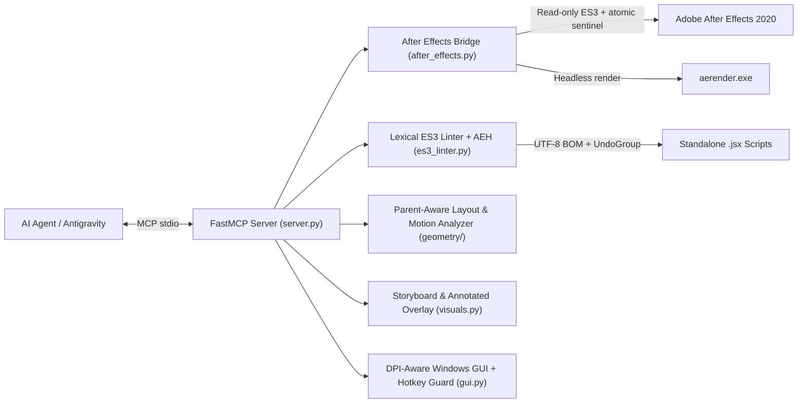

# AE Control MCP (v0.4.0)


-9999FF)


A **Model Context Protocol (MCP) server** and **Antigravity plugin** that bridges AI coding agents with **Adobe After Effects 2020** and Windows desktop automation using a **safe, non-destructive, script-first workflow**.

Instead of directly mutating or overwriting a user's `.aep` project file, `ae-control-mcp` inspects compositions and layers read-only, audits broken expressions and missing footage, validates parent-aware 2D & motion geometry (including **9:16 Reels/TikTok/Shorts** HUD overlays and **WCAG text contrast**), renders annotated previews & storyboards, and generates standalone **ES3 ExtendScript (`.jsx`)** files that the artist reviews and executes manually in After Effects.

---

## Why Script-First?

Direct AI edits to live motion-graphics projects are risky: a wrong keyframe or accidental save can corrupt hours of manual work. **AE Control MCP** enforces a strict safety boundary by design:

1. **Deep Read-Only Inspection & Project Audit** — Inspects open compositions, layer hierarchies, text styles (`font`, `fontSize`, `fillColor`), keyframes, expressions, markers, missing footage, and expression errors without modifying the `.aep` file.
2. **Visual & Timeline Verification** — Renders annotated layout frames (`ae_render_annotated_preview`), multi-frame storyboards (`ae_render_contact_sheet`), and multi-timestamp motion sweeps (`ae_analyze_motion`).
3. **Lexical ES3 Linter & `AEH` Standard Helpers (`ae_write_script`)** — Writes UTF-8 (with BOM) ES3 scripts wrapped in `app.beginUndoGroup(...) / try...catch...finally`, strips strings/comments before linting ES5/ES6 pitfalls (`let`/`const`/`=>`/`.map`/`.forEach`/`Object.keys`/trailing commas/unbalanced braces) with exact line numbers, and optionally injects `AEH` helpers (`findComp`, `hexToRgb`, `centerAnchor`, `easyEase`, `addText`).
4. **Human-in-the-Loop Execution & Code-Level Save Blocking** — Blocks `Ctrl+S` / `Ctrl+W` / `Ctrl+Q` / `Alt+F4` in After Effects at the GUI layer. The user runs `.jsx` scripts manually via **File → Scripts → Run Script File...**, can undo everything in one `Ctrl+Z`, and saves only when satisfied.

---

## Architecture



---

## MCP Tools Reference

### After Effects 2020 (Read-Only Inspection, Layout, Previews & `.jsx` Generation)

| Tool | Description |
| :--- | :--- |
| `ae_get_project_info` | Read-only overview of the active AE project, compositions, layer types (`text`, `shape`, `precomp`, `solid`, `av`, `null`), and timings. |
| `ae_inspect_composition` | Deep read-only inspection of composition markers, layer transforms, keyframe ranges, expressions, `TextDocument` styles, and `ADBE` effect `matchName`s. |
| `ae_audit_project` | Read-only project health audit: missing footage, broken expressions (`expressionError`), fonts used, unused footage, and render queue templates. |
| `ae_analyze_layout` | Parent-aware 2D spatial check (`standard`, `social_vertical` for 9:16 Reels/TikTok/Shorts, or `full` with near-miss alignment checks). |
| `ae_analyze_motion` | Samples composition geometry across multiple timestamps in one AE call and reports time intervals where layers clip, overlap, or enter dead-zones. |
| `analyze_geometry_layout` | Runs spatial layout presets (`standard`, `social_vertical`, `full`) offline on raw JSON geometry without After Effects. |
| `ae_render_frame_preview` | Renders an exact composition frame via `comp.saveFrameToPng` without stealing focus or capturing UI chrome. |
| `ae_render_annotated_preview` | Renders a frame overlaid with Title-Safe / Social UI guides, color-coded layer bounding boxes, and WCAG text-contrast warnings. |
| `ae_render_contact_sheet` | Renders $N$ frames across a composition's work area into a single labeled storyboard contact sheet with timecodes and frame numbers. |
| `ae_write_script` | Writes an ES3 `.jsx` script (UTF-8 BOM, `beginUndoGroup`, optional `include_stdlib=True` `AEH` helpers, lexical ES3 line-numbered linter, and `strict=True` mode). |
| `ae_cleanup_artifacts` | Removes temporary screenshots, preview frames, and `ae_mcp_*` / `ae_frame_*` temp folders while protecting `.jsx` and project files. |
| `ae_render` | Headlessly renders a saved `.aep` composition via `aerender.exe`. |

### Windows GUI Automation

| Tool | Description |
| :--- | :--- |
| `take_screenshot` | DPI-aware full-screen or window-cropped capture with coordinate-mapping metadata (`offset_x/y`, `scale_x/y`). |
| `get_screen_info` | Returns primary display dimensions in physical pixels. |
| `list_windows` / `focus_window` | Lists open desktop windows with bounds and brings a target window to the foreground. |
| `mouse_move` / `mouse_click` / `mouse_drag` / `mouse_scroll` | Mouse automation with optional `target_window` boundary protection. |
| `keyboard_type` / `keyboard_hotkey` | Unicode/Cyrillic-safe text input and hotkey combinations (with built-in save/close shortcut guardrails in After Effects). |

---

## Installation

```powershell
powershell -ExecutionPolicy Bypass -File .\scripts\install_plugin.ps1
```

---

## Running Tests

The offline test suite mocks After Effects and Windows GUI APIs:

```powershell
uv run python -m unittest discover -s tests -v
```

---

## License

[MIT](LICENSE)
