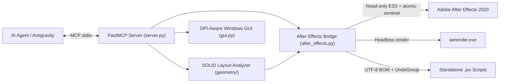

# AE Control MCP


-9999FF)


A **Model Context Protocol (MCP) server** and **Antigravity plugin** that bridges AI coding agents with **Adobe After Effects 2020** and Windows desktop automation using a **safe, non-destructive, script-first workflow**.

Instead of directly mutating or overwriting a user's `.aep` project file, `ae-control-mcp` inspects compositions read-only, validates 2D layout geometry, renders clean frame previews, and generates standalone **ES3 ExtendScript (`.jsx`)** files that the artist reviews and executes manually in After Effects.

---

## Why Script-First?

Direct AI edits to live motion-graphics projects are risky: a wrong keyframe or accidental save can corrupt hours of manual work. **AE Control MCP** enforces a strict safety boundary by design:

1. **Read-Only Project Inspection** — Inspects open compositions, layers, types, timings, bounding boxes, and exact rendered frames without modifying the `.aep` file.
2. **Safe `.jsx` Script Generation (`ae_write_script`)** — Writes UTF-8 (with BOM) ES3 scripts wrapped in `app.beginUndoGroup(...) / try...catch...finally`, with built-in ES3/safety linting that flags ES6+ syntax (`let`/`const`/`=>`/template literals) and accidental `app.project.save()` calls.
3. **Human-in-the-Loop Execution** — The user runs the generated `.jsx` via **File → Scripts → Run Script File...**, can undo everything in a single `Ctrl+Z`, and saves (`Ctrl+S`) only when satisfied.
4. **Protected Artifact Cleanup (`ae_cleanup_artifacts`)** — Cleans up temporary screenshots, preview frames, and leftover `ae_mcp_*` / `ae_frame_*` temp directories while strictly protecting `.jsx`, `.aep`, `.prproj`, `.psd`, `.ai`, and `.ffx` files.

---

## Architecture



### Engineering Highlights

- **Reliable Windows AE 2020 IPC Bridge:**
  - Handles the Windows single-instance quirk where `AfterFX.exe -r script.jsx` hands off execution to a running After Effects process and exits immediately with code `1` before the script finishes.
  - Uses an atomic **result + `.done` sentinel** file protocol with Windows file-lock (`WinError 32`) retry handling and custom ES3 JSON serialization (since AE 2020 ExtendScript has no native `JSON.stringify`).
  - Handles asynchronous `comp.saveFrameToPng()` rendering by polling until the output PNG is completely written, unlocked, and decodable by Pillow.
  - Encodes scripts in **UTF-8 with BOM** so AE 2020 on Windows handles Cyrillic and Unicode layer/text names cleanly.
- **SOLID Spatial Geometry Analyzer (`src/ae_control_mcp/geometry/`):**
  - Protocol-driven architecture (`ScriptRunner`, `GeometryProvider`, `LayoutRule`) decoupled from After Effects for fast offline unit testing.
  - Evaluates **Bounds Check** (out-of-frame & clipped edges), **Title-Safe Margins** (text proximity to frame edges), and **Layer Overlaps** — accounting for layer rotation, negative scale, anchor points, and timeline visibility.
- **DPI-Aware Windows GUI Automation (`src/ae_control_mcp/gui.py`):**
  - Enables `PROCESS_PER_MONITOR_DPI_AWARE` so screenshot coordinates map 1:1 to physical screen pixels.
  - Supports `target_window` bounds enforcement to prevent stray clicks outside the intended application, PyAutoGUI corner fail-safe, and clipboard-backed Unicode/Cyrillic typing.

---

## MCP Tools Reference

### After Effects 2020 (Read-Only, Script Generation & Cleanup)

| Tool | Description |
| :--- | :--- |
| `ae_get_project_info` | Read-only inspection of the active AE project, compositions, layers, types, and timings. |
| `ae_write_script` | Writes an ES3 `.jsx` script (UTF-8 BOM, optional `beginUndoGroup` wrapper, ES3 & save-safety linter). Never runs or saves AE. |
| `ae_cleanup_artifacts` | Removes temporary screenshots, preview frames, and leftover `ae_mcp_*` / `ae_frame_*` temp folders while protecting `.jsx` and project files. Supports `dry_run`. |
| `ae_analyze_layout` | Extracts live 2D layer geometry from AE 2020 and runs bounds, title-safe, and overlap rules. |
| `analyze_geometry_layout` | Runs the same spatial layout rules offline on raw JSON geometry (no AE required). |
| `ae_render_frame_preview` | Renders an exact composition frame via `comp.saveFrameToPng` without stealing focus or capturing UI chrome. |
| `ae_render` | Headlessly renders a saved `.aep` composition via `aerender.exe` (`start_frame`, `end_frame`, `sound`, templates). |

### Windows GUI Automation

| Tool | Description |
| :--- | :--- |
| `take_screenshot` | DPI-aware full-screen or window-cropped capture with coordinate-mapping metadata (`offset_x/y`, `scale_x/y`). |
| `get_screen_info` | Returns primary display dimensions in physical pixels. |
| `list_windows` / `focus_window` | Lists open desktop windows with bounds and brings a target window to the foreground. |
| `mouse_move` / `mouse_click` / `mouse_drag` / `mouse_scroll` | Mouse automation with optional `target_window` boundary protection. |
| `keyboard_type` / `keyboard_hotkey` | Unicode/Cyrillic-safe text input and hotkey combinations. |

---

## Quick Start

### Prerequisites
- **Windows 10/11**
- **Python 3.11+** and [`uv`](https://docs.astral.sh/uv/)
- **Adobe After Effects 2020** with scripting file access enabled:  
  **Edit → Preferences → Scripting & Expressions → Allow Scripts to Write Files and Access Network**

### Installation

```powershell
git clone https://github.com/SolomonJSX/ae-control-mcp.git
cd ae-control-mcp
powershell -ExecutionPolicy Bypass -File .\scripts\install_plugin.ps1
```

`install_plugin.ps1` automatically:
1. Creates or repairs the local `.venv` via `uv sync`.
2. Auto-detects **Adobe After Effects 2020** (`AfterFX.exe` & `aerender.exe`).
3. Installs the Antigravity plugin bundle (`plugin.json`, `mcp_config.json`, `rules/AGENTS.md`, `skills/ae-control/SKILL.md`) into `%USERPROFILE%\.gemini\config\plugins\ae-control\`.

To specify a custom After Effects path manually:
```powershell
powershell -ExecutionPolicy Bypass -File .\scripts\install_plugin.ps1 -AeExePath "D:\Adobe\AE 2020\Support Files\AfterFX.exe"
```

---

## Project Structure

```text
ae-control-mcp/
├── src/ae_control_mcp/
│   ├── server.py            # FastMCP server & tool registration
│   ├── after_effects.py     # AE 2020 ExtendScript bridge, .jsx writer, cleanup & aerender
│   ├── ae_geometry.py       # AE layer bounding-box extractor
│   ├── gui.py               # DPI-aware Windows screenshot, mouse & keyboard control
│   ├── protocols.py         # SOLID interfaces (ScriptRunner, GeometryProvider, LayoutRule)
│   └── geometry/
│       ├── models.py        # Immutable geometry & layout report dataclasses
│       └── analyzers.py     # Bounds, title-safe, and overlap rules
├── plugin/                  # Antigravity plugin bundle (manifest, rules, skill, MCP config)
├── scripts/
│   └── install_plugin.ps1   # One-command setup & plugin installer
├── tests/                   # Unit test suite (20 tests, fully mocked / offline)
├── pyproject.toml
└── uv.lock
```

---

## Running Tests

The test suite mocks After Effects and Windows GUI APIs so all tests run fast and offline:

```powershell
uv run python -m unittest discover -s tests -v
```

---

## License

[MIT](LICENSE)
